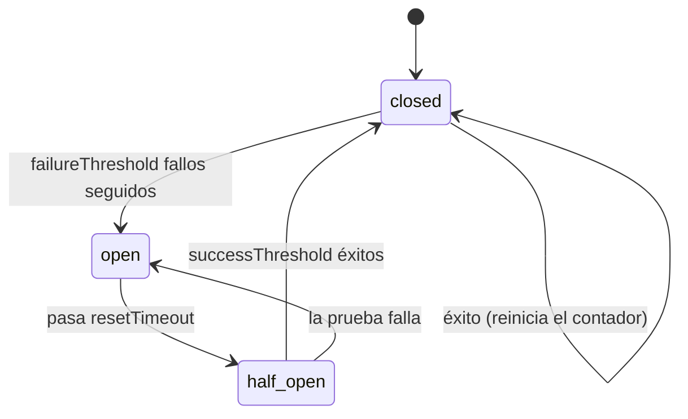

# @jondotsoy/resilience

Ejecuta una función con reintentos y cancelación mediante `AbortSignal`. Sin dependencias.

```sh
npm install @jondotsoy/resilience
```

## Uso

```ts
import { resilience } from "@jondotsoy/resilience";

const res = await resilience({ attempts: 3 }).attempt(({ signal }) =>
  fetch("https://api.example.com/data", { signal }),
);
```

### Sintaxis

```ts
resilience(options).attempt((control) => T | Promise<T>): Promise<T>
```

## Opciones

| Opción     | Tipo                                         | Por defecto | Descripción                                                        |
| ---------- | -------------------------------------------- | ----------- | ------------------------------------------------------------------ |
| `attempts` | `number`                                     | `1`         | Número de intentos antes de rechazar. Debe ser un entero `>= 1`.   |
| `signal`   | `AbortSignal`                                | —           | Cancela el intento en curso y los reintentos pendientes.            |
| `delay`    | `number \| (ctx: DelayContext) => number`     | `0`         | Milisegundos a esperar entre intentos. Con una función puedes calcularlo por intento. La espera se cancela si se aborta `signal`. |
| `onRetry`  | `(event: RetryEvent) => void \| Promise<void>` | —           | Se llama antes de cada reejecución (antes de la espera). Si devuelve una promesa, se espera. |
| `retryable` | `(error, ctx: RetryableContext) => boolean \| Promise<boolean>` | reintenta todo | Si devuelve `false`, rechaza de inmediato con ese error sin reintentar. `ctx` tiene `attempt` (el que falló) y `attempts`. |
| `timeout`  | `number`                                     | —           | Tiempo máximo en ms por intento. Al vencer aborta `control.signal` y el intento falla con `DOMException` `"TimeoutError"`, que se puede reintentar. |
| `fallback` | `(lastError, ctx: FallbackContext) => F \| Promise<F>` | — | Se llama cuando la ejecución falla definitivamente. Lo que devuelva pasa a ser el resultado de `attempt` (el tipo queda `T \| F`). Si lanza, `attempt` rechaza con ese error. No se llama al abortar `signal`. `ctx` tiene `attempt` (intentos ejecutados) y `attempts`. |
| `waitForTask` | `boolean` | `false` | Qué hace `attempt` al abortarse `signal` o vencer `timeout`. `false`: rechaza en ese momento (con `TimeoutError` en un timeout), aunque la tarea siga corriendo. `true`: aborta `control.signal` y espera a la tarea, entregando lo que devuelva o lance. |

`RetryEvent` contiene:

- `attempt`: número del intento que está por ejecutarse (2, 3, ...).
- `attempts`: total de intentos permitidos.
- `error`: error que provocó el reintento.
- `delay`: milisegundos que se esperarán antes de reejecutar.

`DelayContext` contiene `attempt`, `attempts` y `error`.

## Ciclo de vida

Además de `onRetry`, las opciones aceptan hooks `on<Evento>` que se ejecutan en este orden:

```
onStart
  └─ por cada intento: onAttempt → onTimeout? → onError? → onRetry?
onSuccess | onFailure | onAbort
onSettled
```

| Hook        | Argumentos                                         | Cuándo                                                                 |
| ----------- | -------------------------------------------------- | ---------------------------------------------------------------------- |
| `onStart`   | `{ attempt: 0, attempts }`                         | Antes del primer intento.                                              |
| `onAttempt` | `{ attempt, attempts, lastError }`                 | Antes de ejecutar cada intento, incluido el primero.                   |
| `onTimeout` | `{ attempt, attempts, timeout }`                   | Cuando vence el `timeout` de un intento (antes de `onError`).          |
| `onError`   | `(error, { attempt, attempts, willRetry })`        | Cada vez que un intento falla. `willRetry` indica si habrá otro.       |
| `onRetry`   | `{ attempt, attempts, error, delay }`              | Antes de reejecutar, antes de la espera.                               |
| `onSuccess` | `(value, { attempt, attempts })`                   | Cuando un intento termina bien.                                        |
| `onFailure` | `(error, { attempt, attempts })`                   | Cuando falla definitivamente, antes de `fallback`.                     |
| `onAbort`   | `(reason, { attempt, attempts })`                  | Cuando se aborta `signal`. No se llama `onFailure` ni `fallback`.      |
| `onSettled` | `{ status, attempt, attempts, value?, error? }`    | Siempre al final. `status`: `"success"`, `"fallback"`, `"failure"` o `"aborted"`. |

Todos los hooks se esperan si devuelven una promesa. Si un hook lanza, `attempt` rechaza con ese error.

```ts
await resilience({
  attempts: 3,
  timeout: 2_000,
  onAttempt: ({ attempt, attempts }) => console.log(`intento ${attempt}/${attempts}`),
  onError: (error, { willRetry }) => console.warn("falló", error, { willRetry }),
  onSettled: ({ status, attempt }) => metrics.record("fetch_user", { status, attempt }),
}).attempt(({ signal }) => getUser(id, signal));
```

## Control

La función recibe un objeto `control` en cada intento:

- `signal`: `AbortSignal` del intento. Pásalo a `fetch` o a cualquier API cancelable. Se aborta cuando se aborta `options.signal` o cuando vence `options.timeout`.
- `attempt`: número del intento actual, empezando en 1.
- `attempts`: total de intentos permitidos.
- `lastError`: error del intento anterior (o `undefined` en el primero).

## Comportamiento

- Si la función se resuelve, `attempt` devuelve ese valor y no hay más intentos.
- Si `retryable` devuelve `false`, rechaza con ese error sin más intentos.
- Si hay `fallback`, cualquier fallo definitivo (intentos agotados o `retryable` en `false`) se resuelve con lo que devuelva el fallback.
- Si falla en todos los intentos sin `fallback`, `attempt` rechaza con el error del último intento.
- Entre un intento fallido y el siguiente: se llama `onRetry`, luego se espera `delay` ms.
- Si `options.signal` se aborta (incluso durante la espera), `attempt` rechaza en ese momento con `signal.reason` y no reintenta. Con `waitForTask: true`, espera a la tarea y entrega su resultado o su error.

## Ejemplos

Notificar los reintentos:

```ts
await resilience({
  attempts: 5,
  onRetry: ({ attempt, attempts, error }) => {
    console.warn(`Reintento ${attempt}/${attempts}`, error);
  },
}).attempt(({ signal }) => fetch(url, { signal }));
```

### Timeout por intento vs. timeout total

Hay dos formas de poner un límite de tiempo, y se pueden usar juntas:

| | `timeout: ms` | `signal: AbortSignal.timeout(ms)` |
| --- | --- | --- |
| Qué limita | Cada intento por separado | Toda la ejecución, incluidos reintentos y esperas |
| Al vencer | Aborta `control.signal` con `TimeoutError` | Aborta `control.signal` con el `reason` del signal (`TimeoutError`) |
| ¿Se reintenta? | Sí, cuenta como un fallo más | No, `attempt` rechaza de inmediato |

```ts
await resilience({
  attempts: 3,
  timeout: 2_000,                      // cada intento tiene como máximo 2 s
  signal: AbortSignal.timeout(10_000), // y todo junto, como máximo 10 s
  delay: 500,
}).attempt(({ signal }) => fetch(url, { signal }));
```

En ambos casos `control.signal` recibe el evento `abort`, así que basta con pasárselo a `fetch` o a la API que uses.

### ¿Esperar a la tarea o no? (`waitForTask`)

Abortar solo **avisa** a la tarea: si la tarea ignora `control.signal`, puede seguir corriendo. `waitForTask` decide qué hace el `await` de `.attempt()`:

```ts
// Por defecto (waitForTask: false): rechaza apenas vence el timeout o se aborta el signal.
await resilience({ timeout: 1_000 }).attempt(task);
// → TimeoutError al segundo, aunque `task` siga corriendo.

// waitForTask: true: aborta control.signal pero espera a que la tarea termine.
const result = await resilience({ timeout: 1_000, waitForTask: true }).attempt(
  async ({ signal }) => {
    const items: string[] = [];
    let stop = false;

    signal.addEventListener("abort", () => {
      // signal.reason es un TimeoutError: se termina el ítem actual y se corta.
      console.warn("Tiempo agotado, guardando lo procesado", signal.reason);
      stop = true;
    });

    for (const item of queue) {
      if (stop) break;
      items.push(await process(item));
    }

    await save(items);
    return { items, complete: !stop };
  },
);
// → lo que devuelva la tarea; si la tarea lanza, `attempt` rechaza (o reintenta, en un timeout).
```

#### Qué pasa en cada combinación

| Configuración | Al vencer / abortarse | Si la tarea **termina bien** después | Si la tarea **lanza** después | ¿Reintenta? | ¿`fallback`? |
| --- | --- | --- | --- | --- | --- |
| `timeout` | Rechaza en el momento con `TimeoutError` | Se ignora su valor | Se ignora su error | Sí | Sí, si se agotan los intentos |
| `timeout` + `waitForTask: true` | Aborta `control.signal` y espera | `attempt` devuelve ese valor (éxito) | Cuenta como fallo del intento | Sí | Sí, si se agotan los intentos |
| `signal` | Rechaza en el momento con `signal.reason` | Se ignora su valor | Se ignora su error | No | No |
| `signal` + `waitForTask: true` | Aborta `control.signal` y espera | `attempt` devuelve ese valor (éxito) | `attempt` rechaza con el error de la tarea | No | No |

#### `signal: AbortSignal.timeout(10_000)` + `waitForTask: true`

```ts
const result = await resilience({
  attempts: 3,
  delay: 1_000,
  signal: AbortSignal.timeout(10_000),
  waitForTask: true,
}).attempt(async ({ signal }) => {
  signal.addEventListener("abort", () => {
    // A los 10 s: signal.reason es un TimeoutError.
  });
  return await longTask(signal);
});
```

A los 10 s, contados desde que se creó el signal (no desde cada intento):

1. **Si hay un intento corriendo**, se aborta su `control.signal` con el `TimeoutError` y `attempt` **espera** a que la tarea termine:
   - Si la tarea devuelve un valor, `attempt` resuelve con ese valor. Se llama `onSuccess` y `onSettled` con `status: "success"`.
   - Si la tarea lanza, `attempt` rechaza con **ese error** (no con el `TimeoutError`). No se reintenta ni se usa `fallback`; se llama `onAbort` y `onSettled` con `status: "aborted"`.
2. **Si está esperando entre intentos** (`delay`), no hay tarea que esperar: `attempt` rechaza en el momento con el `TimeoutError` y no hace más intentos.
3. **Si el signal ya estaba abortado** antes de llamar a `attempt`, rechaza sin ejecutar la tarea.

En resumen: `waitForTask` solo cambia si se espera a la tarea **que está corriendo**; un signal abortado nunca deja empezar un intento nuevo.

Esperar 500 ms entre intentos:

```ts
await resilience({ attempts: 3, delay: 500 }).attempt(task);
```

Valor alternativo cuando todo falla:

```ts
const user = await resilience({
  attempts: 3,
  fallback: async (lastError) => {
    console.error("No se pudo obtener el usuario", lastError);
    return null;
  },
}).attempt(({ signal }) => getUser(id, signal)); // User | null
```

Timeout de 2 s por intento, solo reintentar errores de servidor:

```ts
class HttpError extends Error {
  constructor(public status: number) {
    super(`HTTP ${status}`);
  }
}

await resilience({
  attempts: 3,
  timeout: 2_000,
  retryable: (error) => !(error instanceof HttpError) || error.status >= 500,
}).attempt(async ({ signal }) => {
  const res = await fetch(url, { signal });
  if (!res.ok) throw new HttpError(res.status);
  return res.json();
});
```

## Backoff

Helpers listos para la opción `delay`. Todos aceptan `{ maxDelay, jitter }`, donde `jitter` puede ser `"full"` (entre 0 y el delay) o `"equal"` (entre la mitad y el delay).

| Helper                              | Serie con `ms = 100`         |
| ----------------------------------- | ---------------------------- |
| `fixedBackoff(ms)`                  | 100, 100, 100, ...           |
| `linearBackoff(ms)`                 | 100, 200, 300, ...           |
| `exponentialBackoff(ms, { factor })` | 100, 200, 400, ... (factor 2) |
| `fibonacciBackoff(ms)`              | 100, 100, 200, 300, 500, ... |

```ts
import { resilience, exponentialBackoff } from "@jondotsoy/resilience";

await resilience({
  attempts: 5,
  delay: exponentialBackoff(200, { maxDelay: 5_000, jitter: "full" }),
  onRetry: ({ attempt, delay }) => console.warn(`Reintento ${attempt} en ${delay} ms`),
}).attempt(task);
```

También puedes pasar tu propia función: `delay: ({ attempt, error }) => ...`.

Todas las utilidades (backoffs, políticas y errores) también están colgadas de la función `resilience`, así que basta con un solo import:

```ts
import { resilience } from "@jondotsoy/resilience";

await resilience({
  attempts: 5,
  delay: resilience.exponentialBackoff(200, { maxDelay: 5_000 }),
}).attempt(task);

const breaker = resilience.circuitBreaker({ failureThreshold: 3 });
```

## Políticas con estado

Además de `resilience`, la lib trae políticas que guardan estado entre llamadas. Créalas **una vez** (por ejemplo, una por servicio) y reutilízalas. Todas exponen `execute(fn)` y se pueden anidar entre sí y con `resilience`.

### circuitBreaker

Tras `failureThreshold` fallos seguidos se **abre** y rechaza al instante con `CircuitOpenError`. Después de `resetTimeout` ms pasa a **half-open** y deja pasar una prueba: si funciona se **cierra**, si falla se vuelve a abrir.

Dos consumidores, **A** y **B**, comparten el mismo breaker (`failureThreshold: 3`, `resetTimeout: 10_000`). Cada punto es una llamada a `breaker.execute()` en el tiempo:

```
         ┌───────── closed ─────────┐  ┌──── open ────┐  half  ┌─── open ───┐half  ┌ closed ┐
tiempo → ─────────────────────────────────────────────────────────────────────────────────────→
A        ●       ✕       ✕       ✕   │     ○       ○   ┊     │ ○       ○   ┊ ◐●  │     ●
B            ●       ●       ✕       │ ○       ○       ┊ ◐✕  │     ○       ┊     │ ●
fallos   0   0   1   0   1   2   3   │     10 s        ┊     │    10 s     ┊     │ 0   0

 ●  llamada exitosa         ✕  llamada fallida (cuenta para failureThreshold)
 ○  rechazada al instante con CircuitOpenError, sin llamar al servicio
 ◐  llamada de prueba en half-open
```

- **El contador es compartido**: los fallos de A y de B suman juntos. El tercer fallo seguido (de A) abre el circuito para **los dos**.
- **Un éxito de cualquiera reinicia el contador**: el `●` de B entre los fallos de A lo devuelve a 0.
- En **open**, A y B reciben `○` durante `resetTimeout`: ninguno llama al servicio.
- Pasado ese tiempo, **solo una llamada** hace la prueba (`◐`), venga de A o de B. Mientras corre, las demás siguen rechazadas.
  - Aquí la primera prueba es de B y falla (`◐✕`): el circuito vuelve a **open** para ambos.
  - La siguiente prueba es de A y funciona (`◐●`): el circuito se **cierra** y B también vuelve a llamar con normalidad.

Por eso el breaker se crea **una vez por servicio** y lo comparten todos los consumidores. Si cada uno tuviera el suyo, B seguiría golpeando un servicio caído que A ya detectó.



| Opción             | Por defecto | Descripción                                        |
| ------------------ | ----------- | -------------------------------------------------- |
| `failureThreshold` | `5`         | Fallos seguidos que abren el circuito.             |
| `resetTimeout`     | `30_000`    | Ms abierto antes de probar de nuevo.               |
| `successThreshold` | `1`         | Éxitos en half-open para cerrarlo.                 |
| `isFailure`        | todos       | `(error) => boolean`, qué errores cuentan como fallo. |
| `onStateChange`    | —           | `(state, previous) => void`.                       |

```ts
const breaker = circuitBreaker({ failureThreshold: 5, resetTimeout: 10_000 });

await breaker.execute(() => fetch(url));
breaker.state; // "closed" | "open" | "half-open"
breaker.reset();
```

### bulkhead

```ts
bulkhead(options) → { execute(fn, { signal }), running, queued }
```

Limita cuántas llamadas corren a la vez. Si hay cupo, la llamada empieza; si no, espera en una cola de tamaño `maxQueue` y sale en orden de llegada cuando se libera un cupo. Con el cupo y la cola llenos, rechaza al instante con `BulkheadRejectedError`.

Tres consumidores, **A**, **B** y **C**, comparten el mismo bulkhead (`maxConcurrent: 1`, `maxQueue: 1`). Cada llamada dura 2 pasos:

```
tiempo → ──────────────────────────────→
A        ●   ─               ◷   ●   ─
B            ◷   ●   ─
C            ○       ◷   ●   ─
en curso 1   1   1   1   1   1   1   1
en cola      1       1       1

 ●  empieza   ─  corriendo   ◷  entra a la cola   ○  rechazada al instante con BulkheadRejectedError
```

- **El cupo es compartido**: entre A, B y C solo corre una llamada a la vez.
- B llega mientras corre A y **espera en la cola** (`◷`). C llega en el mismo paso, con el cupo y la cola llenos, y **se rechaza** (`○`).
- Cuando A termina, **B sale de la cola y empieza** sin volver a llamar a `execute`.
- La cola respeta el **orden de llegada**: después C espera a B, y A espera a C.
- El cupo se libera aunque la llamada falle.

Por eso el bulkhead se crea **una vez por recurso** (una base de datos, un servicio lento) y lo comparten todos los consumidores. Si cada uno tuviera el suyo, entre todos podrían saturar el recurso.

| Opción          | Por defecto | Descripción                                   |
| --------------- | ----------- | --------------------------------------------- |
| `maxConcurrent` | —           | Llamadas en paralelo.                         |
| `maxQueue`      | `0`         | Llamadas esperando turno.                     |
| `signal`        | —           | En `execute`: cancela la espera en la cola.   |

```ts
const db = resilience.bulkhead({
  maxConcurrent: 2,
  maxQueue: 1,
});

export const query = (sql: string, signal?: AbortSignal) =>
  db.execute(() => client.query(sql), { signal });

db.running; // en curso
db.queued;  // esperando
```

### throttle

```ts
throttle(options) → { execute(fn), remaining }
```

Limita la cantidad de llamadas en una ventana deslizante: como máximo `limit` llamadas en cualquier lapso de `interval` ms. Al superarlo rechaza con `ThrottleError`, cuyo `retryAfter` dice cuántos ms faltan para que se libere un cupo. Las llamadas rechazadas no gastan cupo.

Tres consumidores, **A**, **B** y **C**, comparten el mismo throttle (`limit: 3`, `interval: 5 pasos`):

```
tiempo → ──────────────────────────────────────────────→
A        ●   ○               ●                       ●
B        ●       ○               ●                   ●
C        ●                   ●       ○
cupos    0   0   0   0   0   1   0   0   0   0   2   1

 ●  permitida   ○  rechazada al instante con ThrottleError
```

- **El límite es compartido**: A, B y C gastan los 3 cupos en el primer paso, así que el `○` de A y el de B no llaman al servicio.
- Cada `ThrottleError` trae `retryAfter`: el de A dice 4 pasos y el de B 3, lo que falta para que la llamada más antigua salga de la ventana.
- Las rechazadas **no gastan cupo**: cinco pasos después se liberan los 3 cupos del inicio, aunque A y B lo hayan intentado entre medio.
- La ventana es **deslizante**: en cada paso cuentan las llamadas de los últimos 5 pasos, no las de un bloque fijo.

Por eso el throttle se crea **una vez por API** y lo comparten todos los consumidores. Si cada uno tuviera el suyo, entre todos superarían el rate limit.

| Opción     | Por defecto | Descripción                       |
| ---------- | ----------- | --------------------------------- |
| `limit`    | —           | Llamadas permitidas por ventana.  |
| `interval` | —           | Tamaño de la ventana en ms.       |

```ts
const api = resilience.throttle({
  limit: 3,
  interval: 1_000, // 3 por segundo
});

try {
  await api.execute(() => fetch(url));
} catch (error) {
  if (error instanceof resilience.ThrottleError) {
    console.log("reintentar en", error.retryAfter, "ms");
  }
}
```

### cache

```ts
cache(options) → { execute(key, fn), delete(key), clear(), size }
```

Guarda en memoria el resultado de `fn` para una `key` durante `ttl` ms, contados desde que llega el valor. Mientras el valor es válido, los pedidos lo reciben sin llamar al servicio. Si llega un pedido mientras la primera llamada sigue en curso, comparte esa misma ejecución. Los errores no se guardan.

Tres consumidores, **A**, **B** y **C**, piden la misma key a un cache compartido (`ttl: 5 pasos`). El servicio tarda 2 pasos en responder:

```
tiempo → ──────────────────────────────────────────────────────────────→
A        ●   ─           ◆                   ◌✕              ◆
B            ◌                   ◆                   ●   ─
C                ◆                       ✕   ─           ◌
ttl              5   4   3   2   1                           5   4   3

 ●  miss (llama al servicio)   ─  esperando respuesta   ◆  hit   ◌  comparte la llamada en curso
 ✕  miss que falla (el error no se guarda)
```

- A no encuentra el valor y **llama al servicio**. B llega mientras esa llamada sigue en curso y **la comparte** (`◌`) en vez de llamar otra vez.
- Cuando llega el valor se guarda: C, A y B reciben **hits** (`◆`) durante 5 pasos. La fila `ttl` muestra cuánto le queda.
- Al vencer el `ttl` la caché queda vacía y el siguiente pedido, de C, vuelve a llamar. Esa llamada **falla**: A, que la compartía, recibe el mismo error (`◌✕`).
- **El error no se guarda**: B vuelve a llamar, esta vez funciona y el valor queda guardado otros 5 pasos.

Por eso el cache se crea **una vez por tipo de dato** y lo comparten todos los consumidores. Si cada uno tuviera el suyo, cada uno pagaría su propio miss.

| Opción    | Por defecto | Descripción                                               |
| --------- | ----------- | --------------------------------------------------------- |
| `ttl`     | —           | Vida de cada entrada en ms.                               |
| `maxSize` | sin límite  | Máximo de entradas; al superarlo sale la más antigua.     |

```ts
const users = resilience.cache({
  ttl: 60_000,
  maxSize: 500,
});

export const getUser = (id: string) =>
  users.execute(`user:${id}`, () => fetchUser(id));

users.delete("user:42"); // invalidar una entrada
```

### dedupe

```ts
dedupe() → { execute(key, fn), pending }
```

Si ya hay una llamada en curso con la misma `key`, devuelve esa misma promesa en vez de ejecutar `fn` otra vez. No guarda resultados: en cuanto la llamada termina (bien o con error) la key se libera y el siguiente pedido vuelve a llamar.

Sirve cuando varios componentes piden lo mismo al mismo tiempo, por ejemplo la configuración al arrancar.

Tres consumidores, **A**, **B** y **C**, piden la misma key a un dedupe compartido. El servicio tarda 2 pasos en responder:

```
tiempo → ──────────────────────────────────────────────────→
A        ●   ─       ◌                   ◌✕
B            ◌               ●   ─               ●   ─
C                ●   ─               ✕   ─           ◌
pending  1   1   1   1   0   1   1   1   1   0   1   1   0

 ●  llama al servicio   ─  esperando respuesta   ◌  recibe la misma promesa   ✕  llamada que falla
```

- A llama al servicio y B, que llega mientras tanto, **recibe la misma promesa** (`◌`): una sola petición para los dos.
- **No guarda resultados**: en cuanto termina la llamada de A la key queda libre (`pending` vuelve a 0) y el siguiente pedido, de C, vuelve a llamar.
- Si la llamada falla, **todos los que la compartían reciben el error**: C falla y A, que se sumó, recibe el mismo error (`◌✕`).
- Después de un error la key también se libera, así que el siguiente pedido de B vuelve a intentarlo.

A diferencia de `cache`, `dedupe` solo une los pedidos **simultáneos**. Si necesitas reutilizar el valor después de que llegó, usa `cache`.

```ts
const inFlight = resilience.dedupe();

// A, B y C llaman casi a la vez: una sola petición
const [a, b, c] = await Promise.all([
  inFlight.execute("config", loadConfig),
  inFlight.execute("config", loadConfig),
  inFlight.execute("config", loadConfig),
]);
```

### Combinarlas

El orden de anidación define el comportamiento. Por ejemplo, un breaker por fuera hace que toda la secuencia de reintentos cuente como una sola llamada:

```ts
const breaker = circuitBreaker({ failureThreshold: 3 });
const pool = bulkhead({ maxConcurrent: 10 });

const getData = () =>
  breaker.execute(() =>
    resilience({
      attempts: 3,
      timeout: 2_000,
      delay: exponentialBackoff(200),
    }).attempt(({ signal }) => pool.execute(() => fetch(url, { signal }), { signal })),
  );

// Con fallback por fuera, incluso un CircuitOpenError termina en el valor alternativo:
const getDataSafe = () =>
  resilience({ fallback: () => cachedData }).attempt(getData);
```

## Desarrollo

```sh
bun install
bun test
bun run typecheck
bun run build   # compila y prepara dist/ como paquete (package.json, README, LICENSE)
bun run pack    # build + npm pack ./dist → jondotsoy-resilience-<versión>.tgz
```

Para publicar se usa el workflow **Publish** (GitHub Actions, manual). Incrementa la versión (`none`, `patch`, `minor` o `major`), corre typecheck y tests, arma `dist/` y lo deja en staging con `npm stage publish ./dist` usando trusted publishing (OIDC), sin `NPM_TOKEN`. Al terminar sube el commit y el tag `vX.Y.Z` a la rama desde la que se lanzó.

La versión no queda publicada hasta aprobarla con 2FA:

```sh
npm stage list @jondotsoy/resilience
npm stage approve <stage-id> --otp=<código>   # o npm stage reject <stage-id>
```

Para lanzar el workflow:

```sh
gh workflow run Publish --ref develop -f version=patch -f tag=latest -f provenance=true
```

## Licencia

MIT

## Guía: crear un decorador con `resilience`

`resilience` no trae un decorador, pero se arma en pocas líneas. Esta guía usa los decoradores estándar de TypeScript 5 (sin `experimentalDecorators`), que también soporta Bun.

### 1. El decorador

El decorador recibe las opciones, crea el ejecutor una sola vez y reemplaza el método por uno que lo llama dentro de `attempt`. El `control` del intento se agrega como último argumento del método:

```ts
import { resilience, type Control, type ResilienceOptions } from "@jondotsoy/resilience";

export function resilient<This>(
  options: ResilienceOptions | ((self: This) => ResilienceOptions) = {},
) {
  return function <Args extends unknown[], R>(
    method: (this: This, ...args: [...Args, Control?]) => R | Promise<R>,
    _context: ClassMethodDecoratorContext<This>,
  ) {
    // Con opciones fijas, un solo ejecutor para todas las instancias.
    const shared = typeof options === "function" ? undefined : resilience(options);

    return function (this: This, ...args: Args): Promise<R> {
      const r =
        shared ?? resilience((options as (self: This) => ResilienceOptions)(this));
      return r.attempt((control) => method.call(this, ...args, control));
    };
  };
}
```

### 2. Usarlo en una clase

Declara `control` como último parámetro y opcional. TypeScript no deja que un decorador cambie el tipo del método, así que para quien llama el parámetro sigue existiendo, pero no lo pasa: lo pone el decorador en cada intento.

```ts
class UsersApi {
  @resilient({
    attempts: 3,
    timeout: 2_000,
    delay: resilience.exponentialBackoff(200),
  })
  async getUser(id: string, control?: Control) {
    const res = await fetch(`https://api.example.com/users/${id}`, {
      signal: control?.signal,
    });
    if (!res.ok) throw new Error(`HTTP ${res.status}`);
    return res.json();
  }
}

const user = await new UsersApi().getUser("42");
```

Con `control` el método puede cancelar el `fetch` cuando vence el `timeout` y leer `control.attempt` o `control.lastError` si los necesita.

### 3. Opciones por instancia

Si cada objeto tiene su propio `AbortController` (por ejemplo, para cancelar todo al cerrar el servicio), pasa una función que reciba la instancia. En ese caso el ejecutor se crea en cada llamada:

```ts
class Worker {
  readonly abort = new AbortController();

  @resilient((self: Worker) => ({ attempts: 3, signal: self.abort.signal }))
  async process(job: Job, control?: Control) {
    // ...
  }

  close() {
    this.abort.abort();
  }
}
```

### 4. Agregar políticas con estado

Las políticas como `circuitBreaker` o `bulkhead` se usan dentro del método con `execute`. Si las creas fuera de la clase, todas las instancias las comparten, que es lo habitual para un cliente de un mismo servicio:

```ts
const breaker = resilience.circuitBreaker({ failureThreshold: 5 });

class PaymentsApi {
  @resilient({ attempts: 3, delay: resilience.exponentialBackoff(200) })
  async charge(order: Order, control?: Control) {
    return breaker.execute(() =>
      fetch("https://payments.example.com/charge", {
        method: "POST",
        body: JSON.stringify(order),
        signal: control?.signal,
      }),
    );
  }
}
```

### Ten en cuenta

- El `control` va siempre al final, después de los argumentos que pasó quien llama. Si el método tiene parámetros opcionales antes de `control` y se omiten, el `control` quedaría en otra posición. Prefiere parámetros fijos o un objeto de opciones.
- Con opciones fijas, la configuración se comparte entre todas las instancias de la clase.
- El decorador devuelve siempre una promesa, aunque el método original sea síncrono.
