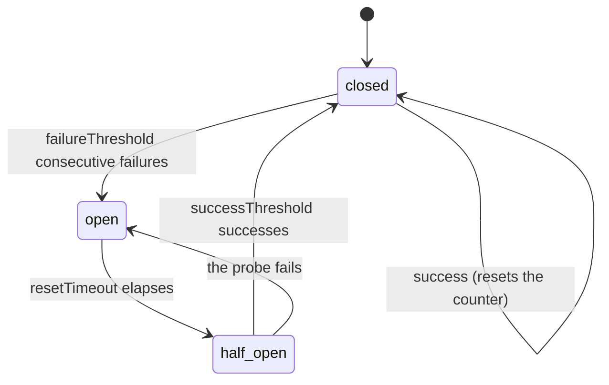

# @jondotsoy/resilience

Run a function with retries and cancellation through `AbortSignal`. Zero dependencies.

```sh
npm install @jondotsoy/resilience
```

## Usage

```ts
import { resilience } from "@jondotsoy/resilience";

const res = await resilience({ attempts: 3 }).attempt(({ signal }) =>
  fetch("https://api.example.com/data", { signal }),
);
```

### Syntax

```ts
resilience(options).attempt((control) => T | Promise<T>): Promise<T>
```

## Options

| Option     | Type                                         | Default     | Description                                                        |
| ---------- | -------------------------------------------- | ----------- | ------------------------------------------------------------------ |
| `attempts` | `number`                                     | `1`         | Number of attempts before rejecting. Must be an integer `>= 1`.    |
| `signal`   | `AbortSignal`                                | —           | Cancels the running attempt and any pending retries.               |
| `delay`    | `number \| (ctx: DelayContext) => number`     | `0`         | Milliseconds to wait between attempts. Pass a function to compute it per attempt. The wait is cancelled if `signal` is aborted. |
| `onRetry`  | `(event: RetryEvent) => void \| Promise<void>` | —           | Called before each retry (before the wait). If it returns a promise, it is awaited. |
| `retryable` | `(error, ctx: RetryableContext) => boolean \| Promise<boolean>` | retries everything | If it returns `false`, rejects immediately with that error without retrying. `ctx` has `attempt` (the one that failed) and `attempts`. |
| `timeout`  | `number`                                     | —           | Maximum time in ms per attempt. When it expires, `control.signal` is aborted and the attempt fails with a `DOMException` `"TimeoutError"`, which can be retried. |
| `fallback` | `(lastError, ctx: FallbackContext) => F \| Promise<F>` | — | Called when the execution fails for good. Whatever it returns becomes the result of `attempt` (the type becomes `T \| F`). If it throws, `attempt` rejects with that error. Not called when `signal` is aborted. `ctx` has `attempt` (attempts executed) and `attempts`. |
| `waitForTask` | `boolean` | `true` | What `attempt` does when `signal` is aborted or `timeout` expires. `true`: aborts `control.signal` and waits for the task, returning whatever it returns or throws. `false`: rejects right away (with `TimeoutError` on a timeout), even if the task keeps running. |

`RetryEvent` contains:

- `attempt`: number of the attempt about to run (2, 3, ...).
- `attempts`: total attempts allowed.
- `error`: the error that caused the retry.
- `delay`: milliseconds to wait before running again.

`DelayContext` contains `attempt`, `attempts` and `error`.

## Lifecycle

Besides `onRetry`, the options accept `on<Event>` hooks that run in this order:

```
onStart
  └─ for each attempt: onAttempt → onTimeout? → onError? → onRetry?
onSuccess | onFailure | onAbort
onSettled
```

| Hook        | Arguments                                          | When                                                                   |
| ----------- | -------------------------------------------------- | ---------------------------------------------------------------------- |
| `onStart`   | `{ attempt: 0, attempts }`                         | Before the first attempt.                                              |
| `onAttempt` | `{ attempt, attempts, lastError }`                 | Before running each attempt, including the first.                      |
| `onTimeout` | `{ attempt, attempts, timeout }`                   | When an attempt's `timeout` expires (before `onError`).                |
| `onError`   | `(error, { attempt, attempts, willRetry })`        | Every time an attempt fails. `willRetry` tells whether another follows. |
| `onRetry`   | `{ attempt, attempts, error, delay }`              | Before running again, before the wait.                                 |
| `onSuccess` | `(value, { attempt, attempts })`                   | When an attempt succeeds.                                              |
| `onFailure` | `(error, { attempt, attempts })`                   | When it fails for good, before `fallback`.                             |
| `onAbort`   | `(reason, { attempt, attempts })`                  | When `signal` is aborted. Neither `onFailure` nor `fallback` is called. |
| `onSettled` | `{ status, attempt, attempts, value?, error? }`    | Always, at the end. `status`: `"success"`, `"fallback"`, `"failure"` or `"aborted"`. |

Every hook is awaited if it returns a promise. If a hook throws, `attempt` rejects with that error.

```ts
await resilience({
  attempts: 3,
  timeout: 2_000,
  onAttempt: ({ attempt, attempts }) => console.log(`attempt ${attempt}/${attempts}`),
  onError: (error, { willRetry }) => console.warn("failed", error, { willRetry }),
  onSettled: ({ status, attempt }) => metrics.record("fetch_user", { status, attempt }),
}).attempt(({ signal }) => getUser(id, signal));
```

## Control

The function receives a `control` object on each attempt:

- `signal`: the attempt's `AbortSignal`. Pass it to `fetch` or any cancellable API. It is aborted when `options.signal` is aborted or when `options.timeout` expires.
- `attempt`: number of the current attempt, starting at 1.
- `attempts`: total attempts allowed.
- `lastError`: error from the previous attempt (or `undefined` on the first one).

## Behavior

- If the function resolves, `attempt` returns that value and no more attempts run.
- If `retryable` returns `false`, it rejects with that error without further attempts.
- If there is a `fallback`, any final failure (attempts exhausted or `retryable` returning `false`) resolves with whatever the fallback returns.
- If every attempt fails and there is no `fallback`, `attempt` rejects with the error from the last attempt.
- Between a failed attempt and the next one: `onRetry` is called, then it waits `delay` ms.
- If `options.signal` is aborted during an attempt, `control.signal` is aborted, `attempt` waits for the task and returns its result or its error, without retrying. If it is aborted during the wait between attempts, it rejects right away with `signal.reason`. With `waitForTask: false`, it always rejects right away with `signal.reason`.

## Examples

Report retries:

```ts
await resilience({
  attempts: 5,
  onRetry: ({ attempt, attempts, error }) => {
    console.warn(`Retry ${attempt}/${attempts}`, error);
  },
}).attempt(({ signal }) => fetch(url, { signal }));
```

### Per-attempt timeout vs. total timeout

There are two ways to set a time limit, and they can be combined:

| | `timeout: ms` | `signal: AbortSignal.timeout(ms)` |
| --- | --- | --- |
| What it limits | Each attempt separately | The whole execution, including retries and waits |
| When it expires | Aborts `control.signal` with `TimeoutError` | Aborts `control.signal` with the signal's `reason` (`TimeoutError`) |
| Retried? | Yes, it counts as one more failure | No, `attempt` rejects immediately |

```ts
await resilience({
  attempts: 3,
  timeout: 2_000,                      // each attempt takes at most 2 s
  signal: AbortSignal.timeout(10_000), // and everything together, at most 10 s
  delay: 500,
}).attempt(({ signal }) => fetch(url, { signal }));
```

In both cases `control.signal` receives the `abort` event, so passing it to `fetch` or whatever API you use is enough.

### Wait for the task or not? (`waitForTask`)

Aborting only **notifies** the task: if the task ignores `control.signal`, it may keep running. `waitForTask` decides what the `await` on `.attempt()` does:

```ts
// waitForTask: false: rejects as soon as the timeout expires or the signal is aborted.
await resilience({ timeout: 1_000, waitForTask: false }).attempt(task);
// → TimeoutError after one second, even if `task` keeps running.

// Default (waitForTask: true): aborts control.signal but waits for the task to finish.
const result = await resilience({ timeout: 1_000 }).attempt(
  async ({ signal }) => {
    const items: string[] = [];
    let stop = false;

    signal.addEventListener("abort", () => {
      // signal.reason is a TimeoutError: finish the current item and stop.
      console.warn("Time is up, saving processed items", signal.reason);
      stop = true;
    });

    for (const item of queue) {
      if (stop) break;
      items.push(await process(item));
    }

    await save(items);
    return { items, complete: !stop };
  },
);
// → whatever the task returns; if the task throws, `attempt` rejects (or retries, on a timeout).
```

#### What happens in each combination

| Configuration | On expiry / abort | If the task **succeeds** afterwards | If the task **throws** afterwards | Retries? | `fallback`? |
| --- | --- | --- | --- | --- | --- |
| `timeout` (default) | Aborts `control.signal` and waits | `attempt` returns that value (success) | Counts as a failed attempt | Yes | Yes, if attempts run out |
| `timeout` + `waitForTask: false` | Rejects right away with `TimeoutError` | Its value is ignored | Its error is ignored | Yes | Yes, if attempts run out |
| `signal` (default) | Aborts `control.signal` and waits | `attempt` returns that value (success) | `attempt` rejects with the task's error | No | No |
| `signal` + `waitForTask: false` | Rejects right away with `signal.reason` | Its value is ignored | Its error is ignored | No | No |

> With the default value, a task that ignores `control.signal` and never finishes leaves `attempt` waiting forever, even if `timeout` expires. If the task does not listen to the abort, use `waitForTask: false`.

#### `signal: AbortSignal.timeout(10_000)` (with the default `waitForTask`)

```ts
const result = await resilience({
  attempts: 3,
  delay: 1_000,
  signal: AbortSignal.timeout(10_000),
}).attempt(async ({ signal }) => {
  signal.addEventListener("abort", () => {
    // After 10 s: signal.reason is a TimeoutError.
  });
  return await longTask(signal);
});
```

After 10 s, counted from when the signal was created (not from each attempt):

1. **If an attempt is running**, its `control.signal` is aborted with the `TimeoutError` and `attempt` **waits** for the task to finish:
   - If the task returns a value, `attempt` resolves with that value. `onSuccess` and `onSettled` are called with `status: "success"`.
   - If the task throws, `attempt` rejects with **that error** (not the `TimeoutError`). There is no retry and no `fallback`; `onAbort` and `onSettled` are called with `status: "aborted"`.
2. **If it is waiting between attempts** (`delay`), there is no task to wait for: `attempt` rejects right away with the `TimeoutError` and makes no more attempts.
3. **If the signal was already aborted** before calling `attempt`, it rejects without running the task.

In short: `waitForTask` only changes whether the **running** task is awaited; an aborted signal never lets a new attempt start.

Wait 500 ms between attempts:

```ts
await resilience({ attempts: 3, delay: 500 }).attempt(task);
```

Fallback value when everything fails:

```ts
const user = await resilience({
  attempts: 3,
  fallback: async (lastError) => {
    console.error("Could not fetch the user", lastError);
    return null;
  },
}).attempt(({ signal }) => getUser(id, signal)); // User | null
```

2 s timeout per attempt, only retry server errors:

```ts
class HttpError extends Error {
  constructor(public status: number) {
    super(`HTTP ${status}`);
  }
}

await resilience({
  attempts: 3,
  timeout: 2_000,
  retryable: (error) => !(error instanceof HttpError) || error.status >= 500,
}).attempt(async ({ signal }) => {
  const res = await fetch(url, { signal });
  if (!res.ok) throw new HttpError(res.status);
  return res.json();
});
```

## Backoff

Ready-made helpers for the `delay` option. All of them accept `{ maxDelay, jitter }`, where `jitter` can be `"full"` (between 0 and the delay) or `"equal"` (between half the delay and the delay).

| Helper                              | Series with `ms = 100`       |
| ----------------------------------- | ---------------------------- |
| `fixedBackoff(ms)`                  | 100, 100, 100, ...           |
| `linearBackoff(ms)`                 | 100, 200, 300, ...           |
| `exponentialBackoff(ms, { factor })` | 100, 200, 400, ... (factor 2) |
| `fibonacciBackoff(ms)`              | 100, 100, 200, 300, 500, ... |

```ts
import { resilience, exponentialBackoff } from "@jondotsoy/resilience";

await resilience({
  attempts: 5,
  delay: exponentialBackoff(200, { maxDelay: 5_000, jitter: "full" }),
  onRetry: ({ attempt, delay }) => console.warn(`Retry ${attempt} in ${delay} ms`),
}).attempt(task);
```

You can also pass your own function: `delay: ({ attempt, error }) => ...`.

Every utility (backoffs, policies and errors) is also attached to the `resilience` function, so a single import is enough:

```ts
import { resilience } from "@jondotsoy/resilience";

await resilience({
  attempts: 5,
  delay: resilience.exponentialBackoff(200, { maxDelay: 5_000 }),
}).attempt(task);

const breaker = resilience.circuitBreaker({ failureThreshold: 3 });
```

## Stateful policies

Besides `resilience`, the library ships policies that keep state across calls. Create them **once** (for example, one per service) and reuse them. They all expose `execute(fn)` and can be nested with each other and with `resilience`.

### circuitBreaker

After `failureThreshold` consecutive failures it **opens** and rejects instantly with `CircuitOpenError`. After `resetTimeout` ms it moves to **half-open** and lets one probe through: if it succeeds it **closes**, if it fails it opens again.

Two consumers, **A** and **B**, share the same breaker (`failureThreshold: 3`, `resetTimeout: 10_000`). Each dot is a call to `breaker.execute()` over time:

```
         ┌───────── closed ─────────┐  ┌──── open ────┐  half  ┌─── open ───┐half  ┌ closed ┐
time   → ─────────────────────────────────────────────────────────────────────────────────────→
A        ●       ✕       ✕       ✕   │     ○       ○   ┊     │ ○       ○   ┊ ◐●  │     ●
B            ●       ●       ✕       │ ○       ○       ┊ ◐✕  │     ○       ┊     │ ●
failures 0   0   1   0   1   2   3   │     10 s        ┊     │    10 s     ┊     │ 0   0

 ●  successful call         ✕  failed call (counts toward failureThreshold)
 ○  rejected instantly with CircuitOpenError, without calling the service
 ◐  probe call in half-open
```

- **The counter is shared**: failures from A and B add up together. The third consecutive failure (from A) opens the circuit for **both**.
- **A success from either one resets the counter**: B's `●` between A's failures brings it back to 0.
- While **open**, A and B get `○` for `resetTimeout`: neither calls the service.
- After that time, **only one call** makes the probe (`◐`), whether from A or B. While it runs, the others are still rejected.
  - Here the first probe is B's and it fails (`◐✕`): the circuit goes back to **open** for both.
  - The next probe is A's and it succeeds (`◐●`): the circuit **closes** and B also calls normally again.

That is why the breaker is created **once per service** and shared by every consumer. If each had its own, B would keep hammering a service that A already knows is down.



| Option             | Default     | Description                                        |
| ------------------ | ----------- | -------------------------------------------------- |
| `failureThreshold` | `5`         | Consecutive failures that open the circuit.        |
| `resetTimeout`     | `30_000`    | Ms open before probing again.                      |
| `successThreshold` | `1`         | Successes in half-open needed to close it.         |
| `isFailure`        | all         | `(error) => boolean`, which errors count as failures. |
| `onStateChange`    | —           | `(state, previous) => void`.                       |

```ts
const breaker = circuitBreaker({ failureThreshold: 5, resetTimeout: 10_000 });

await breaker.execute(() => fetch(url));
breaker.state; // "closed" | "open" | "half-open"
breaker.reset();
```

### bulkhead

```ts
bulkhead(options) → { execute(fn, { signal }), running, queued }
```

Limits how many calls run at once. If there is a free slot, the call starts; otherwise it waits in a queue of size `maxQueue` and leaves in arrival order when a slot frees up. With every slot and the queue full, it rejects instantly with `BulkheadRejectedError`.

Three consumers, **A**, **B** and **C**, share the same bulkhead (`maxConcurrent: 1`, `maxQueue: 1`). Each call lasts 2 steps:

```
time    → ──────────────────────────────→
A         ●   ─               ◷   ●   ─
B             ◷   ●   ─
C             ○       ◷   ●   ─
running   1   1   1   1   1   1   1   1
queued        1       1       1

 ●  starts   ─  running   ◷  enters the queue   ○  rejected instantly with BulkheadRejectedError
```

- **The slots are shared**: among A, B and C only one call runs at a time.
- B arrives while A is running and **waits in the queue** (`◷`). C arrives in the same step, with the slot and the queue full, and **is rejected** (`○`).
- When A finishes, **B leaves the queue and starts** without calling `execute` again.
- The queue respects **arrival order**: then C waits for B, and A waits for C.
- The slot is released even if the call fails.

That is why the bulkhead is created **once per resource** (a database, a slow service) and shared by every consumer. If each had its own, together they could overload the resource.

| Option          | Default     | Description                                   |
| --------------- | ----------- | --------------------------------------------- |
| `maxConcurrent` | —           | Calls in parallel.                            |
| `maxQueue`      | `0`         | Calls waiting for their turn.                 |
| `signal`        | —           | In `execute`: cancels the wait in the queue.  |

```ts
const db = resilience.bulkhead({
  maxConcurrent: 2,
  maxQueue: 1,
});

export const query = (sql: string, signal?: AbortSignal) =>
  db.execute(() => client.query(sql), { signal });

db.running; // running
db.queued;  // waiting
```

### throttle

```ts
throttle(options) → { execute(fn), remaining }
```

Limits the number of calls in a sliding window: at most `limit` calls in any span of `interval` ms. When exceeded it rejects with `ThrottleError`, whose `retryAfter` says how many ms remain until a slot frees up. Rejected calls do not use up slots.

Three consumers, **A**, **B** and **C**, share the same throttle (`limit: 3`, `interval: 5 steps`):

```
time    → ──────────────────────────────────────────────→
A         ●   ○               ●                       ●
B         ●       ○               ●                   ●
C         ●                   ●       ○
slots     0   0   0   0   0   1   0   0   0   0   2   1

 ●  allowed   ○  rejected instantly with ThrottleError
```

- **The limit is shared**: A, B and C use the 3 slots in the first step, so A's `○` and B's `○` do not call the service.
- Each `ThrottleError` carries `retryAfter`: A's says 4 steps and B's says 3, the time left until the oldest call leaves the window.
- Rejected calls **do not use up slots**: five steps later the 3 initial slots are freed, even though A and B tried in between.
- The window is **sliding**: at each step, the calls from the last 5 steps count, not those from a fixed block.

That is why the throttle is created **once per API** and shared by every consumer. If each had its own, together they would exceed the rate limit.

| Option     | Default     | Description                       |
| ---------- | ----------- | --------------------------------- |
| `limit`    | —           | Calls allowed per window.         |
| `interval` | —           | Window size in ms.                |

```ts
const api = resilience.throttle({
  limit: 3,
  interval: 1_000, // 3 per second
});

try {
  await api.execute(() => fetch(url));
} catch (error) {
  if (error instanceof resilience.ThrottleError) {
    console.log("retry in", error.retryAfter, "ms");
  }
}
```

### cache

```ts
cache(options) → { execute(key, fn), delete(key), clear(), size }
```

Stores the result of `fn` in memory for a `key` during `ttl` ms, counted from when the value arrives. While the value is valid, requests receive it without calling the service. If a request arrives while the first call is still in flight, it shares that same execution. Errors are not cached.

Three consumers, **A**, **B** and **C**, request the same key from a shared cache (`ttl: 5 steps`). The service takes 2 steps to respond:

```
time    → ──────────────────────────────────────────────────────────────→
A         ●   ─           ◆                   ◌✕              ◆
B             ◌                   ◆                   ●   ─
C                 ◆                       ✕   ─           ◌
ttl               5   4   3   2   1                           5   4   3

 ●  miss (calls the service)   ─  waiting for the response   ◆  hit   ◌  shares the in-flight call
 ✕  failing miss (the error is not cached)
```

- A does not find the value and **calls the service**. B arrives while that call is still in flight and **shares it** (`◌`) instead of calling again.
- When the value arrives it is stored: C, A and B get **hits** (`◆`) for 5 steps. The `ttl` row shows how much time is left.
- When the `ttl` expires the cache is empty and the next request, from C, calls again. That call **fails**: A, which was sharing it, gets the same error (`◌✕`).
- **The error is not cached**: B calls again, this time it succeeds and the value is stored for another 5 steps.

That is why the cache is created **once per data type** and shared by every consumer. If each had its own, each would pay for its own miss.

| Option    | Default     | Description                                               |
| --------- | ----------- | --------------------------------------------------------- |
| `ttl`     | —           | Lifetime of each entry in ms.                             |
| `maxSize` | unlimited   | Maximum entries; when exceeded, the oldest is evicted.    |

```ts
const users = resilience.cache({
  ttl: 60_000,
  maxSize: 500,
});

export const getUser = (id: string) =>
  users.execute(`user:${id}`, () => fetchUser(id));

users.delete("user:42"); // invalidate an entry
```

### dedupe

```ts
dedupe() → { execute(key, fn), pending }
```

If there is already a call in flight with the same `key`, it returns that same promise instead of running `fn` again. It does not store results: as soon as the call finishes (successfully or with an error) the key is released and the next request calls again.

Useful when several components request the same thing at the same time, for example the configuration at startup.

Three consumers, **A**, **B** and **C**, request the same key from a shared dedupe. The service takes 2 steps to respond:

```
time    → ──────────────────────────────────────────────────→
A         ●   ─       ◌                   ◌✕
B             ◌               ●   ─               ●   ─
C                 ●   ─               ✕   ─           ◌
pending   1   1   1   1   0   1   1   1   1   0   1   1   0

 ●  calls the service   ─  waiting for the response   ◌  receives the same promise   ✕  failing call
```

- A calls the service and B, arriving in the meantime, **receives the same promise** (`◌`): a single request for both.
- **It does not store results**: as soon as A's call finishes the key is free (`pending` goes back to 0) and the next request, from C, calls again.
- If the call fails, **everyone sharing it receives the error**: C fails and A, which joined, gets the same error (`◌✕`).
- After an error the key is released too, so B's next request tries again.

Unlike `cache`, `dedupe` only merges **simultaneous** requests. If you need to reuse the value after it arrived, use `cache`.

```ts
const inFlight = resilience.dedupe();

// A, B and C call almost at once: a single request
const [a, b, c] = await Promise.all([
  inFlight.execute("config", loadConfig),
  inFlight.execute("config", loadConfig),
  inFlight.execute("config", loadConfig),
]);
```

### Combining them

The nesting order defines the behavior. For example, a breaker on the outside makes the whole retry sequence count as a single call:

```ts
const breaker = circuitBreaker({ failureThreshold: 3 });
const pool = bulkhead({ maxConcurrent: 10 });

const getData = () =>
  breaker.execute(() =>
    resilience({
      attempts: 3,
      timeout: 2_000,
      delay: exponentialBackoff(200),
    }).attempt(({ signal }) => pool.execute(() => fetch(url, { signal }), { signal })),
  );

// With a fallback on the outside, even a CircuitOpenError ends in the fallback value:
const getDataSafe = () =>
  resilience({ fallback: () => cachedData }).attempt(getData);
```

## Guide: build a decorator with `resilience`

`resilience` does not ship a decorator, but you can build one in a few lines. This guide uses TypeScript 5 standard decorators (without `experimentalDecorators`), which Bun also supports.

### 1. The decorator

The decorator receives the options, creates the executor once and replaces the method with one that calls it inside `attempt`. The attempt's `control` is appended as the method's last argument:

```ts
import { resilience, type Control, type ResilienceOptions } from "@jondotsoy/resilience";

export function resilient<This>(
  options: ResilienceOptions | ((self: This) => ResilienceOptions) = {},
) {
  return function <Args extends unknown[], R>(
    method: (this: This, ...args: [...Args, Control?]) => R | Promise<R>,
    _context: ClassMethodDecoratorContext<This>,
  ) {
    // With fixed options, a single executor for every instance.
    const shared = typeof options === "function" ? undefined : resilience(options);

    return function (this: This, ...args: Args): Promise<R> {
      const r =
        shared ?? resilience((options as (self: This) => ResilienceOptions)(this));
      return r.attempt((control) => method.call(this, ...args, control));
    };
  };
}
```

### 2. Use it in a class

Declare `control` as the last, optional parameter. TypeScript does not let a decorator change the method's type, so the parameter still exists for the caller, but they do not pass it: the decorator supplies it on each attempt.

```ts
class UsersApi {
  @resilient({
    attempts: 3,
    timeout: 2_000,
    delay: resilience.exponentialBackoff(200),
  })
  async getUser(id: string, control?: Control) {
    const res = await fetch(`https://api.example.com/users/${id}`, {
      signal: control?.signal,
    });
    if (!res.ok) throw new Error(`HTTP ${res.status}`);
    return res.json();
  }
}

const user = await new UsersApi().getUser("42");
```

With `control` the method can cancel the `fetch` when the `timeout` expires and read `control.attempt` or `control.lastError` if it needs them.

### 3. Per-instance options

If each object has its own `AbortController` (for example, to cancel everything when the service shuts down), pass a function that receives the instance. In that case the executor is created on every call:

```ts
class Worker {
  readonly abort = new AbortController();

  @resilient((self: Worker) => ({ attempts: 3, signal: self.abort.signal }))
  async process(job: Job, control?: Control) {
    // ...
  }

  close() {
    this.abort.abort();
  }
}
```

### 4. Add stateful policies

Policies like `circuitBreaker` or `bulkhead` are used inside the method with `execute`. If you create them outside the class, every instance shares them, which is the usual setup for a client of a single service:

```ts
const breaker = resilience.circuitBreaker({ failureThreshold: 5 });

class PaymentsApi {
  @resilient({ attempts: 3, delay: resilience.exponentialBackoff(200) })
  async charge(order: Order, control?: Control) {
    return breaker.execute(() =>
      fetch("https://payments.example.com/charge", {
        method: "POST",
        body: JSON.stringify(order),
        signal: control?.signal,
      }),
    );
  }
}
```

### Keep in mind

- `control` always goes last, after the arguments the caller passed. If the method has optional parameters before `control` and they are omitted, `control` would end up in a different position. Prefer fixed parameters or an options object.
- With fixed options, the configuration is shared by every instance of the class.
- The decorator always returns a promise, even if the original method is synchronous.

## License

MIT
